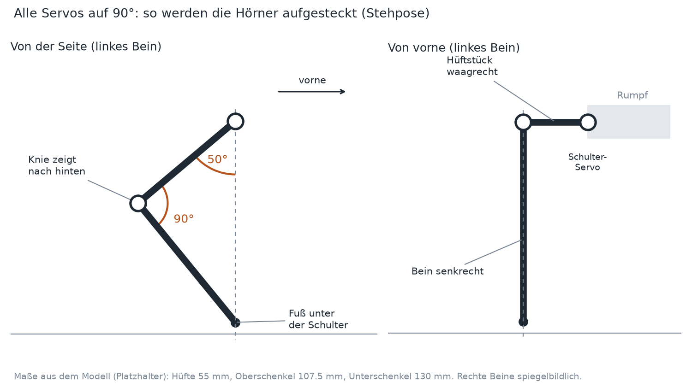

# Zusammenbau und Kalibrierung

Kurzanleitung für den Bau von Nova. Ausführlich steht alles in
`neuronales-netz-plan.md` (Abschnitt 5.4 und 5.5).

## 1. Vorher messen

Bevor die Teile verschraubt sind:

- **Wiegen:** alle gedruckten Teile, die Powerbank, Schrauben und Lager
  zusammen. Servo (67 g), Pi (46 g), PCA9685 (13 g) und LiPo (265 g) sind
  schon gewogen.
- **Beinlängen**, jeweils von Drehachse zu Drehachse: Hüftstück (Schulterachse
  bis Oberschenkel-Achse, seitlich), Oberschenkel (bis Knie-Achse), Unterschenkel
  (Knie-Achse bis Fußspitze). Im Modell stehen noch die Werte des
  Spot-Micro-Originals: 55 / 107,5 / 130 mm.

## 2. Servos

- Alle 15 Servos stehen auf 90° und sind nummeriert (20.11.2026). **Nicht mehr
  von Hand verdrehen**, sonst stimmt die Mittelstellung nicht mehr.
- 12 kommen in den Hund, 3 bleiben Ersatz.
- Kanäle am PCA9685:

| Bein | Schulter | Oberschenkel | Knie |
|---|---|---|---|
| vorne links (FL) | 0 | 1 | 2 |
| vorne rechts (FR) | 3 | 4 | 5 |
| hinten links (RL) | 6 | 7 | 8 |
| hinten rechts (RR) | 9 | 10 | 11 |

Schreib dir beim Einbauen auf, welche Servo-Nummer an welchem Gelenk sitzt.

## 3. Hörner aufstecken: Stehpose bei 90°

Die Hörner kommen so auf die Servos (die ja auf 90° stehen), dass das Bein in
der **Stehpose** ist:

- **Schulter:** Hüftstück waagrecht, das Bein hängt von vorne gesehen
  senkrecht nach unten.
- **Oberschenkel:** 50° aus der Senkrechten **nach hinten** geneigt. Das Knie
  liegt hinter der Schulter.
- **Knie:** Unterschenkel im rechten Winkel (90°) zum Oberschenkel. Der Fuß
  steht dann ungefähr senkrecht unter der Schulter.

Das Horn rastet nur in Stufen ein (bei 25 Zähnen alle 14,4°). Nimm die
Stellung, die am nächsten dran ist. Den Rest (bis ca. ±7°) gleicht die
Kalibrierung aus. Die rechten Beine sind spiegelbildlich, dort drehen die
Servos andersherum. Das ist normal, die Kalibrierung merkt das.

## 4. Kalibrieren (am Pi)

Hund **aufbocken** (Beine hängen frei), jemand hält den XT60-Stecker, Servostrom an:

    cd ~/nova
    git pull
    .venv/bin/python src/calibrate.py --hardware

Das Programm geht alle 12 Gelenke nacheinander durch. Es bewegt immer nur
eins, höchstens 10° auf einmal und langsam. Für jedes Gelenk:

1. Mit `+2`, `-5`, `+0.5` usw. drehen, bis die **Bezugslage** erreicht ist, dann `ref`.
2. `dir`: Das Gelenk dreht 5°, du sagst, ob es in die Plus-Richtung ging (`j`/`n`).
3. Langsam in eine Richtung bis kurz vor den Anschlag (bevor etwas anstößt),
   dann `min`. In die andere Richtung, dann `max`.
4. `ok`. Mit `q` kannst du jederzeit abbrechen.

| Gelenk | Bezugslage (`ref`) | Plus-Richtung (`dir`) |
|---|---|---|
| Schulter | Bein von vorne gesehen senkrecht | Bein geht nach außen |
| Oberschenkel | Oberschenkel von der Seite gesehen senkrecht | Oberschenkel nach vorne |
| Knie | Knie im rechten Winkel (Geodreieck) | Knie weiter zu (mehr gebeugt) |

Gespeichert wird nach jedem Gelenk in `~/nova-kalibrierung.json`. Abbrechen
und später weitermachen geht: `--joint FR_lower` macht nur ein Gelenk.
Meldet das Programm, dass die Stehpose außerhalb der Grenzen liegt, sitzt
das Horn um einen Zahn versetzt: umstecken und das Gelenk neu kalibrieren.

Danach die Datei auf den Laptop holen und als `calibration.json` ins Repo
legen (macht Claude): Ab dann rechnen `servos.py`, die Hauptschleife und
auch die Simulation mit den echten Werten.

## 5. Erste Bewegungen (Plan 5.5)

Immer aufgebockt anfangen, jemand am Stecker:

    .venv/bin/python src/controller.py --hardware --seconds 10

Ohne `--policy` und ohne `--speed` steht Nova nur auf: Liegepose senden,
Servostrom an, Enter, langsam aufstehen, stehen, hinlegen. Danach Schritt
für Schritt: `--speed 50`, dann das Netz mit `--policy
model/policies/nova_residual_v1.onnx --k 0.25`. Mit `--log logs/lauf1.csv`
wird jeder Takt mitgeschrieben.
